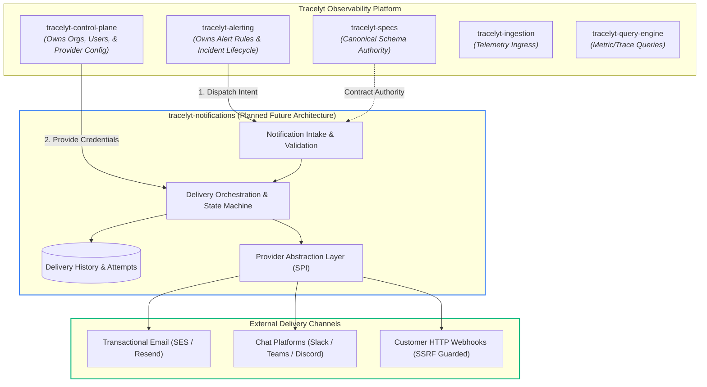

<p align="center">
  
</p>

# Tracelyt Notifications (`tracelyt-notifications`)

[](https://github.com/Tracelyt-Systems/tracelyt-notifications/actions/workflows/ci.yml)
[](https://github.com/Tracelyt-Systems/tracelyt-notifications/actions/workflows/documentation.yml)
[](LICENSE)
[](https://openjdk.org/projects/jdk/21/)
[](https://spring.io/projects/spring-boot)

**Tracelyt Notifications** is the dedicated multi-channel notification orchestration and delivery subsystem of **Tracelyt**, an open-source observability platform.

This repository owns the notification intake, state lifecycle, channel selection, provider abstraction, retry orchestration, and delivery observability for notifications generated across the Tracelyt platform.

---

> ### ⚠️ CURRENT DEVELOPMENT STATUS: REPOSITORY FOUNDATION & ARCHITECTURE ONLY
> 
> This repository is currently in **Stage 1 (Repository Foundation & Architecture Setup)**. 
> - **Included**: Project structure, comprehensive architectural specifications, threat models, CI/CD pipelines, static analysis, and a minimal Java 21 LTS + Spring Boot 3.4.x application bootstrap context test.
> - **NOT Implemented**: No actual email delivery, no SMTP connections, no provider SDKs (SES, SendGrid, Slack, Teams, Discord), no production webhooks, no databases, no Kafka/RabbitMQ queues, and no mock delivery bypasses.
> - All referenced delivery systems and adapter flows represent **future planned architecture**.

---

## 1. Tracelyt Platform Relationship & Service Boundaries

Tracelyt is engineered as a decoupled, multi-service observability platform. `tracelyt-notifications` maintains strictly enforced service boundaries:



### Boundary Division Matrix

| Platform Service | Service Owns | Notifications Subsystem Does NOT Own |
| :--- | :--- | :--- |
| **`tracelyt-alerting`** | Alert rule evaluation, incident lifecycle, alert grouping, deduplication, suppression, escalation policies, and generating notification intents. | Notification does not evaluate alert rules, query metric thresholds, or alter incident states upon delivery failures. |
| **`tracelyt-control-plane`**| Tenant/user authentication, organization memberships, provider credential configuration, notification channel preferences, and quotas. | Notification does not manage user accounts, login flows, or global organization policies. |
| **`tracelyt-specs`** | Shared API specifications, Protocol Buffer contracts, event envelopes, and versioning rules. | Notification does not unilaterally define conflicting message schemas. |
| **`tracelyt-query-engine`** | Executing metrics, logs, and distributed trace queries across telemetry storage. | Notification does not execute arbitrary queries against platform telemetry data stores. |
| **`tracelyt-deploy`** | Helm charts, Kubernetes operators, Docker Compose, and infrastructure provisioning. | Notification does not manage platform-wide deployment manifests. |

For detailed boundary definitions, see [System Boundaries](docs/architecture/system-boundaries.md).

---

## 2. Conceptual Notification Lifecycle

When implemented, notification requests will progress through a 12-stage conceptual lifecycle:

1. **Notification Intent Dispatch**: An authorized Tracelyt service (e.g., `tracelyt-alerting`) emits an approved notification intent.
2. **Intake & Authentication**: Request is received via authenticated REST or event stream.
3. **Schema Validation**: Request payload is validated against canonical `tracelyt-specs` schemas.
4. **Tenant Context Verification**: Cryptographic validation of tenant and project boundaries.
5. **Idempotency Check**: Deduplication key evaluated against the 24-hour cache to prevent duplicate deliveries.
6. **Routing & Preferences**: Tenant-specific routing rules and provider configurations are resolved from `tracelyt-control-plane`.
7. **Channel & Provider Selection**: Appropriate adapter selected based on channel, capability, and health status.
8. **Message Preparation & Escaping**: Message rendered using approved templates with context-aware HTML/Markdown escaping.
9. **Delivery Execution**: Outbound HTTP/TLS call executed with strict connection and read timeouts.
10. **Receipt & State Recording**: Delivery attempt timestamp, provider message ID, and HTTP status recorded.
11. **Retry / DLQ Handling**: Transient failures (HTTP 429/503) scheduled for exponential backoff; permanent failures routed to Dead-Letter Queue.
12. **Status Reporting**: Terminal delivery receipts made available to authorized platform services.

See [Notification Lifecycle](docs/architecture/notification-lifecycle.md) for stage-by-stage specifications.

---

## 3. Multi-Channel & Provider Strategy

`tracelyt-notifications` is architected around a provider-agnostic adapter Service Provider Interface (SPI):

- **Transactional Email**: Amazon SES, Resend, and SendGrid evaluated as candidate providers. Clean HTML/text multipart rendering, bounce/complaint handling hooks.
- **Chat Platforms**: Slack (Webhook & Bot API), Microsoft Teams (Adaptive Cards), and Discord (Webhooks).
- **Generic HTTP Webhooks**: Secure outbound webhook dispatcher featuring **mandatory SSRF defense**, private RFC 1918 IP blacklisting, DNS rebinding guards, TLS certificate verification, and HMAC-SHA256 payload signing.

For detailed channel analyses and adapter designs, see [Channel Strategy](docs/architecture/channel-strategy.md) and [Provider Model](docs/architecture/provider-model.md).

---

## 4. Delivery Reliability & Semantics

- **At-Least-Once Delivery**: Systems are engineered with the realistic recognition that network partitions make at-least-once delivery standard. Callers must supply stable idempotency keys.
- **Exponential Backoff with Full Jitter**: Retries calculate wait times as $T_{\text{wait}} = \text{random}(0, \min(T_{\text{max}}, T_{\text{initial}} \times 2^{\text{attempt}}))$ and honor provider `Retry-After` headers.
- **Delivery Status Semantics**: Strict distinction between:
  - `ACCEPTED`: Acknowledged by Tracelyt intake.
  - `PROCESSING`: Leased by delivery worker.
  - `PROVIDER_ACCEPTED`: Acknowledged by third-party provider gateway (e.g., SES 200 OK).
  - `DELIVERED`: Confirmed end-to-end receipt (where webhook callback supported).
  - `FAILED`: Permanently rejected and moved to Dead-Letter Queue.

Read [Delivery Reliability](docs/architecture/delivery-reliability.md) for comprehensive recovery and failure mechanics.

---

## 5. Security Architecture

Security is foundational to the notification subsystem:
- **SSRF Defense**: Outbound webhook requests strictly validate target IPs, reject loopback/private ranges (`127.0.0.0/8`, `10.0.0.0/8`, `169.254.169.254`), prohibit HTTP redirects (`Redirect.NEVER`), and defend against DNS rebinding.
- **Zero-Secret Logging**: Automatic masking of all `Authorization`, `X-Api-Key`, and secret tokens in SLF4J log appenders.
- **Tenant Isolation**: Mandatory tenant scoping across all state records and provider credential mappings.
- **Supply Chain Security**: GitHub Actions pinned to immutable 40-character commit SHAs; weekly Dependabot scans.

Explore the complete security documentation:
- [Threat Model (STRIDE)](docs/security/threat-model.md)
- [Webhook Security & SSRF Protection](docs/security/webhook-security.md)
- [Secret Management](docs/security/secret-management.md)
- [Tenant Isolation](docs/security/tenant-isolation.md)
- [Supply Chain Security](docs/security/supply-chain.md)

---

## 6. Technology Strategy

- **Runtime**: Java 21 (LTS) on HotSpot JVM.
- **Framework**: Spring Boot 3.4.3 with minimal core starters.
- **Concurrency**: Java 21 Virtual Threads (`Project Loom`) enabled via `spring.threads.virtual.enabled=true` for high-density outbound I/O without reactive complexity.
- **Build System**: Apache Maven with Maven Wrapper (`./mvnw`).
- **Static Analysis**: Checkstyle 10.21.4 with zero-violation enforcement.

Review [Technology Strategy](docs/architecture/technology-strategy.md) and [Language Boundaries](docs/architecture/language-boundaries.md).

---

## 7. Local Development & Build Validation

### Prerequisites
- JDK 21 (LTS) installed and configured on your `PATH`.
- Git 2.40+.
- Python 3.10+ (for documentation validation tooling).

### Build Commands

```bash
# Checkstyle static analysis and project model validation
./mvnw -B -ntp clean validate checkstyle:check     # Linux / macOS
mvnw.cmd -B -ntp clean validate checkstyle:check   # Windows

# Execute automated tests
./mvnw -B -ntp test                               # Linux / macOS
mvnw.cmd -B -ntp test                             # Windows

# Package application JAR (skipping tests)
./mvnw -B -ntp package -DskipTests                # Linux / macOS
mvnw.cmd -B -ntp package -DskipTests              # Windows

# Validate documentation links and absence of exposed secrets
python tools/validate_docs.py
```

### Makefile Convenience
If `make` is installed on your workstation:
```bash
make validate    # Runs checkstyle static analysis
make test        # Runs unit tests
make build       # Packages application JAR
make docs-check  # Validates documentation and link integrity
make clean       # Removes build target artifacts
```

---

## 8. Documentation Index

The complete documentation suite is organized in [`docs/`](docs/README.md):

| Category | Key Documents |
| :--- | :--- |
| **Architecture** | [Overview](docs/architecture/overview.md) • [System Boundaries](docs/architecture/system-boundaries.md) • [Domain Model](docs/architecture/domain-model.md) • [Notification Lifecycle](docs/architecture/notification-lifecycle.md) • [Channel Strategy](docs/architecture/channel-strategy.md) • [Provider Model](docs/architecture/provider-model.md) • [Delivery Reliability](docs/architecture/delivery-reliability.md) • [Messaging Strategy](docs/architecture/messaging-strategy.md) • [Storage Strategy](docs/architecture/storage-strategy.md) • [Rate Limiting](docs/architecture/rate-limiting.md) • [Template Strategy](docs/architecture/template-strategy.md) • [Scalability](docs/architecture/scalability.md) • [Technology Strategy](docs/architecture/technology-strategy.md) • [Language Boundaries](docs/architecture/language-boundaries.md) • [Deployment Models](docs/architecture/deployment-models.md) • [Diagrams](docs/architecture/diagrams/README.md) |
| **Decisions (ADRs)** | [ADR Index](docs/decisions/README.md) • [ADR Template](docs/decisions/adr-template.md) • [ADR-0001: Java 21 + Spring Boot Foundation](docs/decisions/0001-adopt-java21-spring-boot-foundation.md) |
| **Development** | [Local Setup](docs/development/local-setup.md) • [Project Structure](docs/development/project-structure.md) • [Coding Standards](docs/development/coding-standards.md) • [Testing Strategy](docs/development/testing-strategy.md) • [Dependency Management](docs/development/dependency-management.md) • [Contribution Workflow](docs/development/contribution-workflow.md) |
| **Security** | [Security Overview](docs/security/README.md) • [Threat Model](docs/security/threat-model.md) • [Secret Management](docs/security/secret-management.md) • [Webhook Security](docs/security/webhook-security.md) • [Tenant Isolation](docs/security/tenant-isolation.md) • [Data Privacy](docs/security/data-privacy.md) • [Secure Development](docs/security/secure-development.md) • [Supply Chain](docs/security/supply-chain.md) |
| **Operations** | [Observability](docs/operations/observability.md) • [Configuration](docs/operations/configuration.md) • [Resource Limits](docs/operations/resource-limits.md) • [Capacity Planning](docs/operations/capacity-planning.md) • [Disaster Recovery](docs/operations/disaster-recovery.md) • [Deployment Readiness](docs/operations/deployment-readiness.md) |
| **Standards** | [Contract Governance](docs/standards/contract-governance.md) • [Compatibility](docs/standards/compatibility.md) • [Error Handling](docs/standards/error-handling.md) • [Event Governance](docs/standards/event-governance.md) • [Performance Testing](docs/standards/performance-testing.md) |
| **Roadmap** | [Roadmap Index](docs/roadmap/README.md) • [Architecture Evolution](docs/roadmap/architecture-evolution.md) |

---

## 9. Current Limitations

1. **No External Network Delivery**: No actual emails, chat messages, or webhooks can be dispatched.
2. **No Persistent Database**: Ingestion requests are verified in-memory; no PostgreSQL, MySQL, or Mongo schemas are connected.
3. **No Message Brokers**: Kafka, RabbitMQ, and Redis dependencies are intentionally omitted from this baseline.
4. **Contract Dependency**: Final intake contracts await formal publication and approval in `tracelyt-specs`.

---

## 10. Contributing and Community

We welcome contributions! Please review our community guides before opening a pull request:
- [Contributing Guidelines](CONTRIBUTING.md)
- [Code of Conduct](CODE_OF_CONDUCT.md)
- [Project Governance](GOVERNANCE.md)
- [Security Policy](SECURITY.md)
- [Maintainers List](MAINTAINERS.md)
- [Support Guide](SUPPORT.md)

---

## 11. License

This project is licensed under the **Apache License 2.0**. See the [LICENSE](LICENSE) and [NOTICE](NOTICE) files for details.
