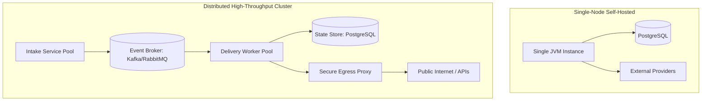

# Deployment Models and Egress Topologies

This document outlines the conceptual deployment topologies and network egress requirements for the future `tracelyt-notifications` service.

> **Important**: Platform-wide deployment manifests (Docker Compose, Helm charts, Kubernetes operators, and Terraform modules) are owned and maintained by the [`tracelyt-deploy`](system-boundaries.md) repository. This document defines the operational requirements and deployment patterns specific to notification delivery.

---

## 1. Supported Deployment Topologies

### 1.1 Local Development
- **Target Audience**: Developers contributing to `tracelyt-notifications`.
- **Packaging**: Runnable JAR executed via `./mvnw spring-boot:run` or standalone container.
- **Dependencies**: In-memory mock/noop adapter mode or local test containers (PostgreSQL / MailHog) for delivery destination testing.

### 1.2 Single-Node Self-Hosted (Docker Compose)
- **Target Audience**: Small-to-medium deployments seeking straightforward operational maintenance.
- **Packaging**: Single container image combining intake, scheduling, and delivery worker loops.
- **State Store**: Shared PostgreSQL database instance provided by `tracelyt-deploy`.
- **Concurrency**: Managed via JVM thread pools (utilizing Java 21 Virtual Threads for high-density I/O).

### 1.3 High-Throughput Distributed Cluster (Kubernetes)
- **Target Audience**: Multi-tenant cloud or large enterprise installations.
- **Topology**: Decoupled deployment manifests:
  - **Intake Pool**: Horizontally scaled stateless pods serving HTTP/gRPC ingress from alerting and control-plane services.
  - **Worker Pool**: Asynchronous delivery workers scaled based on queue depth and egress rate limits.
  - **Retry & Reaper CronJobs**: Lightweight jobs handling delayed retries and dead-letter queue inspection.

---

## 2. Network Egress and Security Zones

Notification delivery is inherently an outbound-heavy workload requiring connections to third-party APIs (SendGrid, Slack, Discord) and customer-controlled webhook destinations.

### 2.1 Egress Architecture
1. **Direct Egress (Default / Self-Hosted)**:
   - Worker pods initiate outbound TLS connections directly to external provider domains.
   - Requires firewall clearance for ports 443 (HTTPS) and 587/465 (SMTP, if applicable).
2. **Dedicated Egress Proxy (Enterprise / Restricted Clouds)**:
   - Worker pods route outbound traffic through a hardened forward proxy (e.g., Envoy or Squid).
   - Allows strict egress IP whitelisting for corporate customers and centralizes outbound audit logging.

### 2.2 Webhook Egress Isolation
To prevent Server-Side Request Forgery (SSRF) and network reconnaissance:
- Webhook dispatch workers must be deployed in a dedicated network segment (DMZ / isolated VPC).
- Outbound network policies must enforce:
  - Strict denial of all RFC 1918 private subnets (`10.0.0.0/8`, `172.16.0.0/12`, `192.168.0.0/16`).
  - Denial of link-local and cloud metadata endpoints (`169.254.169.254`).
  - DNS resolution enforced through a validating recursive resolver that rejects non-routable IP responses.

---

## 3. Container Resource Guidelines (Planned)

| Component Profile | Base Memory Limit | Recommended CPU | Storage Requirement |
| :--- | :--- | :--- | :--- |
| **Combined Dev / Self-Hosted** | 512 MB – 1 GB | 0.5 – 1.0 Core | Stateless (Logs via stdout) |
| **Intake Service (K8s pod)** | 512 MB | 0.5 Core | Stateless |
| **Delivery Worker (K8s pod)** | 1 GB – 2 GB | 1.0 – 2.0 Core | Stateless |

JVM tuning guidelines:
- `-XX:MaxRAMPercentage=75.0`
- `-XX:+UseG1GC` or `-XX:+UseZGC` for low-latency garbage collection.

---

## 4. Related Documentation

- [System Boundaries](system-boundaries.md)
- [Scalability](scalability.md)
- [Webhook Security](../security/webhook-security.md)
- [Deployment Readiness](../operations/deployment-readiness.md)
