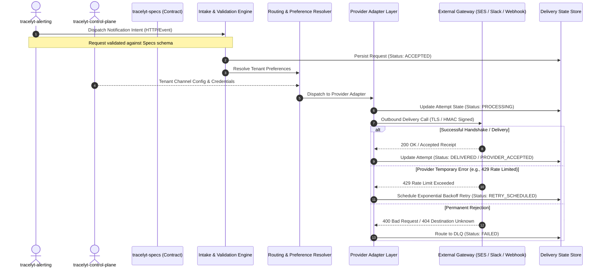
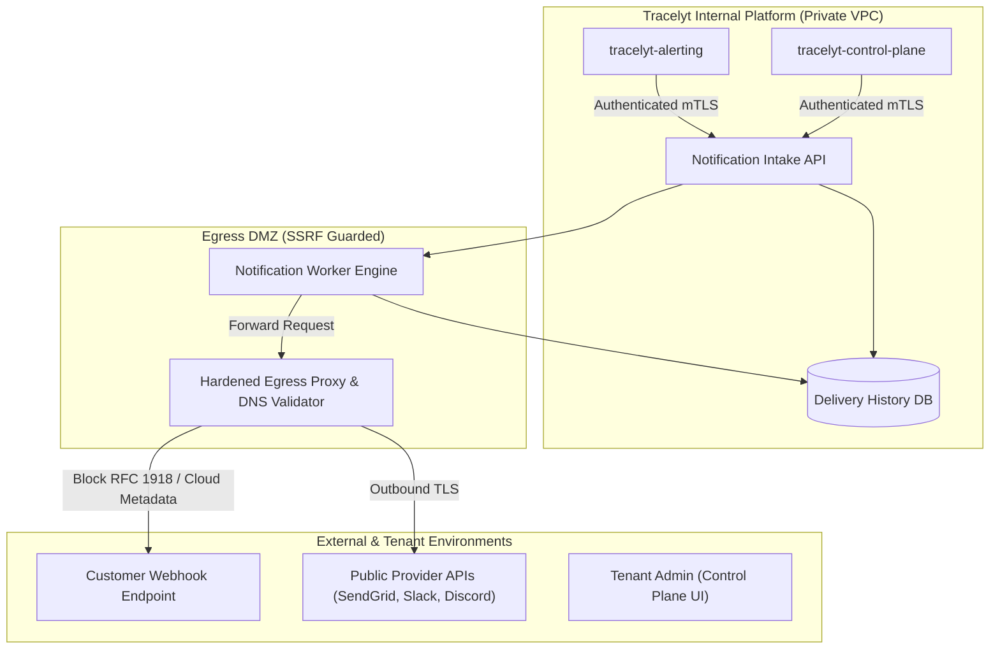
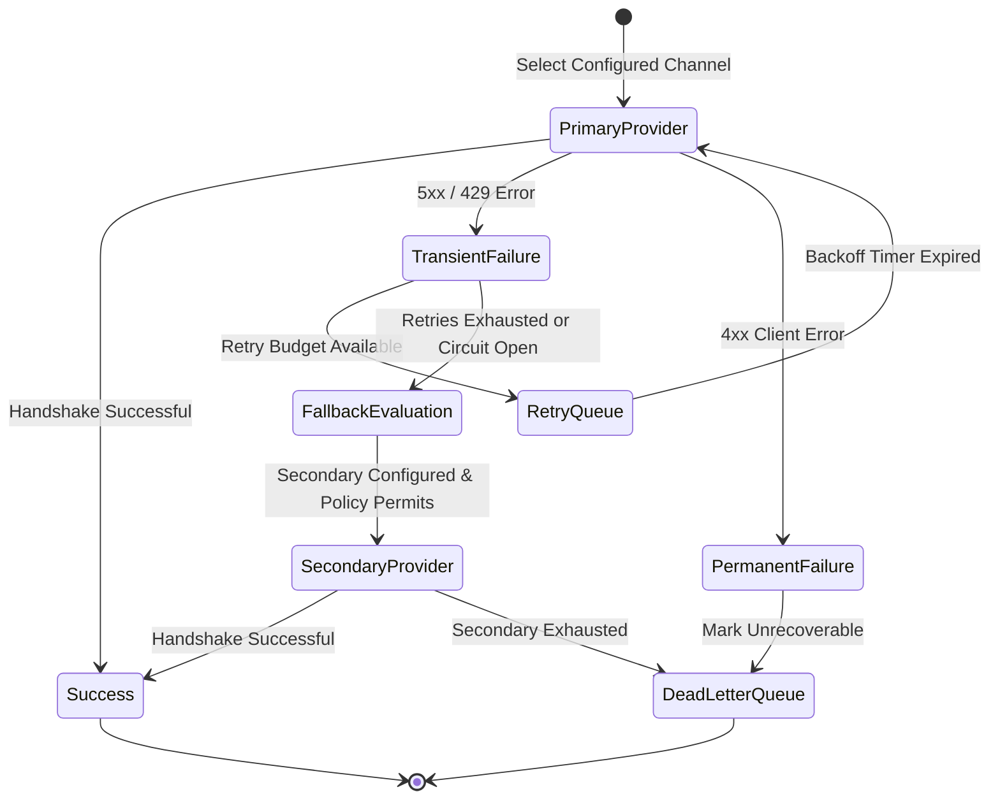

# Architecture Diagrams

This directory contains conceptual visual architecture diagrams for the `tracelyt-notifications` service, rendered using GitHub-compatible [Mermaid](https://mermaid.js.org/) syntax.

> **Status Notice**: All diagrams represent planned architectural designs. No actual notification delivery or infrastructure components are implemented during repository bootstrap.

---

## 1. High-Level Delivery Flow & System Boundaries

---

## 2. Trust Boundaries and Isolation Architecture

---

## 3. Provider Failover State Machine

---

## 4. Related Documentation

- [Architecture Overview](../overview.md)
- [System Boundaries](../system-boundaries.md)
- [Delivery Reliability](../delivery-reliability.md)
- [Provider Model](../provider-model.md)
- [Threat Model](../../security/threat-model.md)
