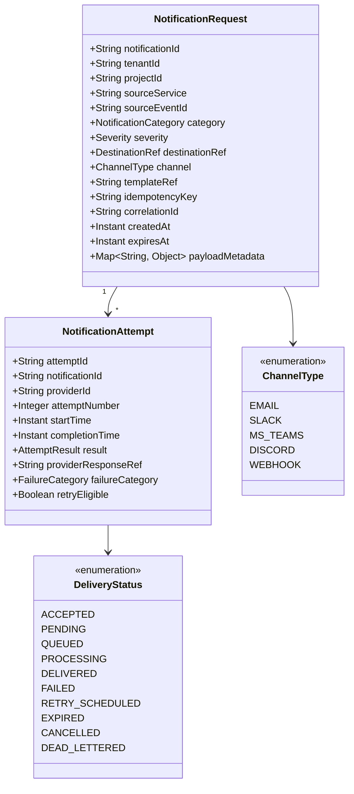

# Notification Domain Model

This document outlines the core domain entities, delivery attempt models, status lifecycles, and recipient destination concepts planned for `tracelyt-notifications`.

> **Governance Notice:** Concrete JSON and Protobuf schemas for these domain entities must be reviewed and approved in [`tracelyt-specs`](https://github.com/Tracelyt-Systems/tracelyt-specs). This document defines the conceptual domain model.

---

## 1. Domain Entities & Relationships

---

## 2. Key Entity Specifications

### 2.1 Notification Request
- **`notificationId`:** Globally unique, time-sortable identifier (e.g., ULID or UUIDv7).
- **`idempotencyKey`:** Deterministic key provided by caller to guarantee that duplicate network submissions do not generate multiple deliveries.
- **`expiresAt`:** Execution deadline after which late attempts are aborted (e.g., an urgent paging notification older than 30 minutes is dead-lettered rather than woken up late).

### 2.2 Notification Attempt
- **`attemptNumber`:** Monotonically increasing attempt counter (1, 2, 3...).
- **`failureCategory`:** Classifies failure into `TRANSIENT` (rate limit, network timeout) vs. `PERMANENT` (invalid email syntax, unauthorized 401 token, blacklisted IP).

### 2.3 Delivery Status Semantics
To prevent misleading claims of delivery success, Tracelyt differentiates status precision:

| Status | Meaning | Practical Guarantee |
|---|---|---|
| **`ACCEPTED`** | Request received and schema validated by Tracelyt. | Enqueued for delivery processing. |
| **`PROCESSING`** | Handed to provider adapter for transport dispatch. | Socket connection open. |
| **`DELIVERED`** | External provider accepted message HTTP 200/202. | Provider accepted for delivery. *(Does not guarantee recipient opened/read message).* |
| **`RETRY_SCHEDULED`**| Transient failure encountered; backoff timer set. | Re-attempt pending. |
| **`FAILED`** | Permanent error or retry budget exhausted. | Final failed state. |
| **`DEAD_LETTERED`** | Exceeded maximum retries; quarantined for review. | Stored in dead-letter archive. |

---

## 3. Recipient & Destination Taxonomy

Destinations vary significantly across channels:
- **`UserRecipient`:** Mapped to user profile email or personal notification preference.
- **`ChannelDestination`:** Shared team channel (e.g., Slack `#alerts-prod` or Discord `#ops`).
- **`WebhookEndpoint`:** Outbound HTTP(S) URL configured with mutual secret signing.
