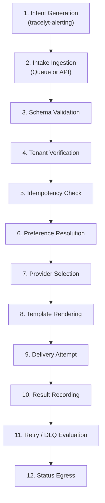

# Notification Lifecycle Architecture

This document details the 12-stage conceptual lifecycle of a notification, from initial event intent to terminal delivery confirmation.

> **Status Notice:** This document establishes design specifications for notification orchestration. No runtime dispatchers, template engines, or delivery workers are implemented in this repository foundation.

---

## 1. Conceptual Lifecycle Flow

---

## 2. Stage Breakdown & Ownership

| Stage | Name | Subsystem Responsibility | Key Actions & Invariants |
|---|---|---|---|
| **1** | **Intent Generation** | `tracelyt-alerting` | Upstream service identifies that an incident requires human notification. Emits intent envelope with `idempotency_key`. |
| **2** | **Intake Ingestion** | `tracelyt-notifications` | Ingests intent via asynchronous message queue or internal REST endpoint. |
| **3** | **Schema Validation** | `tracelyt-notifications` | Validates payload against `tracelyt-specs`. Rejects malformed requests immediately with `400 Bad Request`. |
| **4** | **Tenant Verification** | `tracelyt-notifications` | Verifies `tenant_id` and project quota allocations against cached control-plane policies. |
| **5** | **Idempotency Check** | `tracelyt-notifications` | Checks idempotency cache. If request has already been processed, returns cached status without re-sending. |
| **6** | **Preference Resolution**| `tracelyt-notifications` | Resolves target recipient to configured destination channels (e.g., team on-call schedule or Slack room). |
| **7** | **Provider Selection** | `tracelyt-notifications` | Selects active provider adapter (e.g., SES for email, Slack Web API) and verifies provider health. |
| **8** | **Template Rendering** | `tracelyt-notifications` | Compiles channel-appropriate message body with strict HTML/markdown escaping to prevent injection. |
| **9** | **Delivery Attempt** | `tracelyt-notifications` | Executes outbound network dispatch bounded by strict socket timeouts (5–10s) and SSRF guards. |
| **10**| **Result Recording** | `tracelyt-notifications` | Logs `NotificationAttempt` with response status code, round-trip latency, and attempt count. |
| **11**| **Retry / Failure** | `tracelyt-notifications` | On transient failure, schedules exponential backoff. If max attempts exhausted, moves to Dead-Letter Queue (DLQ). |
| **12**| **Status Egress** | `tracelyt-notifications` | Publishes `DELIVERED` or `FAILED` status event back to platform event bus for audit logging. |
