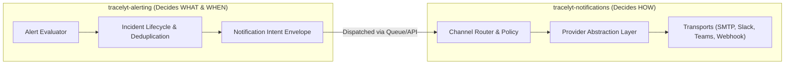
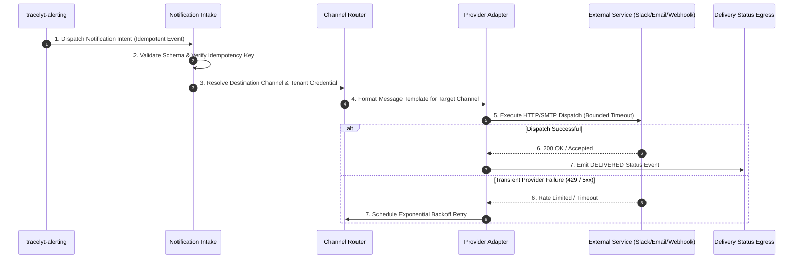

# Architecture Overview: Tracelyt Notifications

This document outlines the architectural role, core responsibilities, and system boundaries of `tracelyt-notifications` within the Tracelyt Observability Platform.

---

## 1. Subsystem Identity & Purpose

**Tracelyt Notifications** is the multi-channel notification orchestration and delivery subsystem of the Tracelyt platform.

Its primary responsibility is to provide a reliable, secure, multi-tenant delivery engine that:
1. Ingests approved notification requests and intents from upstream services (such as `tracelyt-alerting` and `tracelyt-control-plane`).
2. Validates recipient references and resolves tenant delivery preferences.
3. Translates generic notification payloads into channel-specific formats (Email, Slack, MS Teams, Discord, Webhooks).
4. Dispatches messages across external provider transports with rate limiting, backoff retries, and dead-letter handling.
5. Emits structured delivery status updates back to the platform for auditability and operational monitoring.

> **Status Notice:** This repository is currently in **Stage 1 (Foundation)**. No actual email dispatchers, Slack/Teams SDK integrations, production webhook clients, database drivers, Kafka/Redis queues, or mock delivery endpoints are implemented.

---

## 2. Core Delivery Boundary Principle

To maintain modularity and avoid monolithic coupling, Tracelyt strictly separates alert lifecycle tracking from notification delivery:

- **`tracelyt-alerting` decides WHAT and WHEN:** Determines whether an alert condition warrants notification, applies suppression/silences, groups alerts into incidents, and emits an idempotent notification intent.
- **`tracelyt-notifications` decides HOW:** Resolves recipient destinations to concrete provider credentials, formats message templates, manages provider API rate limits, handles connection retries, and records delivery receipts.
- **Critical Invariant:** A notification delivery failure (e.g., third-party Slack outage) must **never** alter the underlying alert or incident state in `tracelyt-alerting`.

---

## 3. High-Level Subsystem Flow

