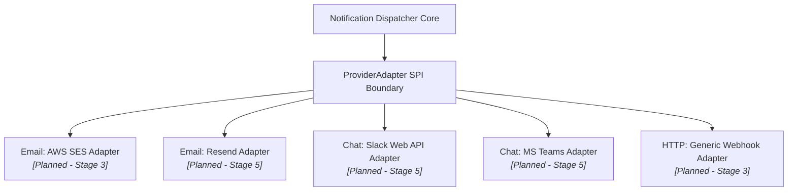

# Provider Abstraction & Adapter Architecture

This document outlines the decoupled provider architecture, capability negotiation, error classification, and adapter boundary planned for `tracelyt-notifications`.

> **Status Notice:** This document establishes design specifications for provider adapters. No fake provider classes, speculative Java interfaces, or vendor SDKs (AWS SDK, SendGrid, Slack API) are implemented in this repository foundation.

---

## 1. Provider Adapter Pattern

To prevent vendor lock-in and decouple core notification orchestration from third-party APIs, the system designs a clean **Provider Adapter SPI**:

---

## 2. Adapter Responsibilities & Contract

Every future provider adapter must satisfy standard responsibilities:
1. **Capability Negotiation:** Declares supported channels, maximum payload byte sizes, supported formatting (HTML, Markdown, plain text), and rate limit constraints.
2. **Payload Translation:** Converts canonical Tracelyt notification entities into provider-specific wire formats (e.g., converting incident details into Slack Block Kit JSON or SendGrid REST payloads).
3. **Execution & Timeout:** Executes network dispatches strictly bounded by execution deadlines (default: 5 seconds connect, 10 seconds read).
4. **Error Normalization:** Normalizes third-party HTTP and network errors into platform-standard failure categories:
   - `TRANSIENT_RETRYABLE`: HTTP 429 Too Many Requests, HTTP 500/502/503/504, TCP socket timeout.
   - `PERMANENT_REJECTED`: HTTP 400 Bad Request, HTTP 401/403 Invalid Credentials, HTTP 404 Destination Not Found, Malformed Email Syntax.

---

## 3. Provider Failover Policies

In future multi-provider environments (Stage 7):
- **Primary / Fallback Routing:** If a primary provider (e.g., AWS SES) experiences consecutive timeouts or trips a circuit breaker, traffic can fail over to a pre-configured secondary provider (e.g., Resend).
- **Duplicate Prevention During Failover:** If a primary attempt times out ambiguously after socket write, failover must evaluate whether duplicate delivery is acceptable before re-dispatching across secondary providers.
