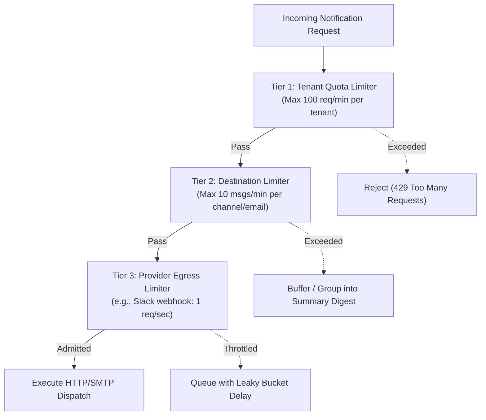

# Rate Limiting & Abuse Prevention Architecture

This document defines the multi-tiered rate limiting controls, burst mitigation, and notification storm prevention strategies for `tracelyt-notifications`.

---

## 1. Multi-Tiered Rate Limiting Model

Notification systems face severe rate limiting risks from both sides:
- **Inbound Abuse:** A malfunctioning alert rule emits 10,000 notifications in 10 seconds.
- **Outbound Provider Throttling:** Third-party APIs (Slack, Discord, SendGrid) enforce strict rate limits; exceeding them results in HTTP 429 penalties or account suspension.

---

## 2. Leaky Bucket Egress Rate Limiting

To comply with third-party provider limits, outbound dispatchers implement a **Leaky Bucket** per destination:
- **Slack Incoming Webhooks:** Throttled to 1 message per second with a burst capacity of 5.
- **Discord Webhooks:** Throttled to 30 requests per minute.
- **Email Providers:** Throttled based on tenant SES/SendGrid daily quota envelopes.

---

## 3. Notification Storm Mitigation & Digestion

When an infrastructure incident impacts hundreds of services simultaneously:
- **Frequency Throttling:** If more than 10 alerts target the same Slack channel within a 60-second window, subsequent alerts are automatically collapsed into a single **Incident Summary Digest** message rather than spamming 100 individual channel pings.
- **Emergency Priority Overrides:** High-severity (`CRITICAL`) alerts are granted priority queue lanes, bypassing non-critical digests.
