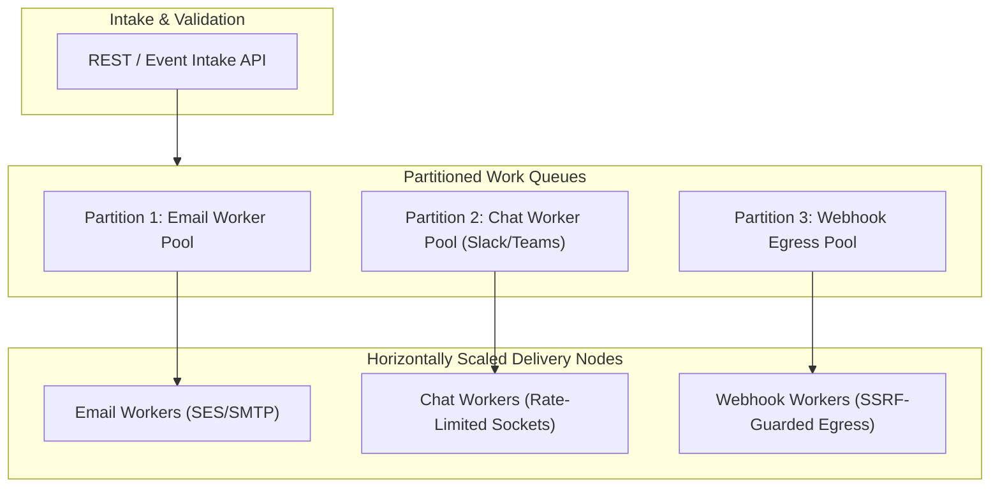

# Scalability & Distributed Delivery Architecture

This document describes the architectural progression from a single-process coordinator to horizontally partitioned delivery worker pools in `tracelyt-notifications`.

> **Status Notice:** No distributed worker pools or microservice partitions are implemented in this repository foundation. The recommended initial architecture is a monolithic deployable container.

---

## 1. Single-Process vs. Distributed Delivery Topology

| Dimension | Single-Process Coordinator (Stages 1–4) | Distributed Worker Pool (Stage 6) |
|---|---|---|
| **Delivery Throughput** | Up to ~200 notifications / second | 1,000 to 10,000+ notifications / second |
| **Operational Footprint** | Extremely low; single container and relational DB | High; requires message broker cluster, partitioned queues |
| **State Consistency** | Immediate in-process synchronization | Distributed locks, partition leasing, dead-letter routing |
| **Current Foundation Status** | **Approved Initial Architecture** | **Deferred to Stage 6 (Scale & Reliability)** |

---

## 2. Horizontal Scaling & Work Partitioning (Future Stage 6)

When notification volume requires horizontal distribution:

### Partitioning Dimensions
1. **Channel-Based Worker Pools:** Isolates slow external network endpoints (e.g., third-party webhooks taking 5 seconds to respond) from fast chat APIs (Slack taking 100ms), preventing head-of-line blocking.
2. **Provider-Specific Concurrency:** Caps maximum concurrent sockets per provider to respect external API quotas.
3. **Queue Backpressure:** Workers dynamically adjust intake rates using queue depth metrics.
