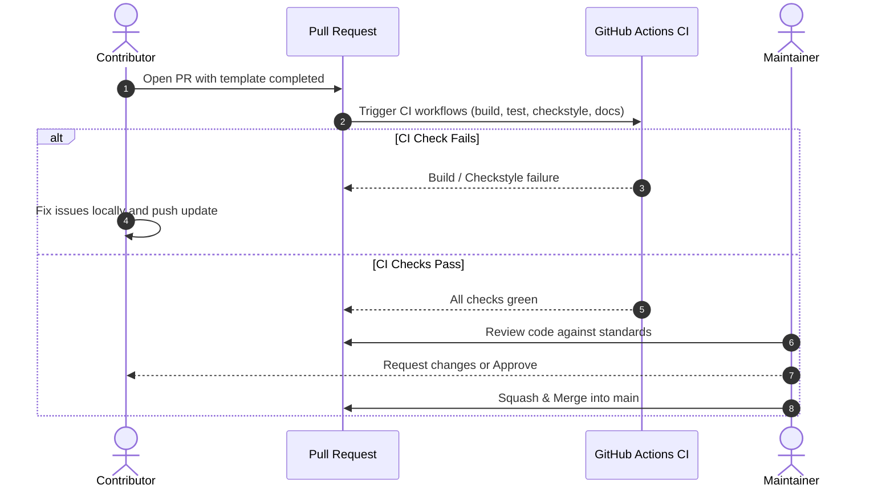

# Contribution Workflow and Developer Lifecycle

This document describes the branch management, Pull Request guidelines, and code review expectations for contributing to `tracelyt-notifications`.

---

## 1. Branching Strategy

- **`main`**: The primary branch representing the stable, verified baseline. Direct pushes to `main` are restricted.
- **Feature Branches**: Branch names should be descriptive and prefixed:
  - `feat/channel-email-adapter`
  - `fix/webhook-ssrf-validation`
  - `docs/clarify-idempotency-policy`
  - `refactor/provider-registry`

---

## 2. Pull Request Lifecycle

---

## 3. Pull Request Checklist

Before opening or requesting review on a Pull Request:
1. **Title & Description**: Complete all sections of the [Pull Request Template](../../.github/PULL_REQUEST_TEMPLATE.md).
2. **Local Validation**:
   - Run `./mvnw clean validate checkstyle:check` — zero violations allowed.
   - Run `./mvnw test` — all tests must pass.
   - Run `python tools/validate_docs.py` — ensure documentation links resolve.
3. **Commit Cleanliness**: Avoid noisy merge commits; rebase onto `main` before submitting.
4. **Documentation**: Any architectural change or new convention must include corresponding updates in `docs/`.

---

## 4. Code Review Standards

Maintainers review PRs based on:
- **Architectural Fit**: Does the change respect established service boundaries (e.g., avoiding alert evaluation in the notification service)?
- **Security Posture**: Does the change introduce unvalidated webhook destinations, raw secret logging, or SSRF risks?
- **Simplicity**: Does the PR adhere to the minimal dependency principle without speculative abstractions?

---

## 5. Related Documentation

- [Contributing Guidelines](../../CONTRIBUTING.md)
- [Coding Standards](coding-standards.md)
- [Testing Strategy](testing-strategy.md)
- [Maintainers List](../../MAINTAINERS.md)
