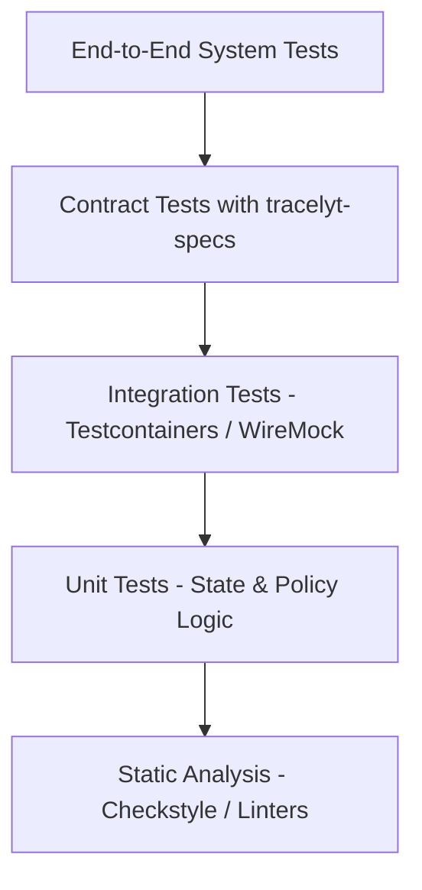

# Testing Strategy and Quality Assurance

This document defines the automated testing principles, levels of testing, and non-blocking validation guidelines for `tracelyt-notifications`.

---

## 1. Testing Pyramid



---

## 2. Testing Levels

### 2.1 Unit Testing (Implemented)
- **Scope**: Core domain entities, state transitions, validation logic, retry policy backoff calculations, and Spring application context bootstrapping.
- **Rules**:
  - Must execute entirely in-memory without network calls or external daemon processes.
  - Must complete in seconds.
  - Zero flakiness tolerated.
- **Baseline Test**: [`NotificationsApplicationTest.java`](../../src/test/java/io/tracelyt/notifications/NotificationsApplicationTest.java) verifies that the Spring context loads successfully with minimal starters.

### 2.2 Integration Testing (Planned)
- **Scope**: Outbound HTTP provider adapters, database persistence, and message broker integration.
- **Tooling**:
  - **WireMock**: Simulates external provider APIs (SendGrid, Slack, Discord) to verify timeout handling, retry behavior on HTTP 429/500, and header signing without hitting live vendor endpoints.
  - **Testcontainers**: Spawns isolated PostgreSQL containers for testing delivery attempt persistence and concurrent deduplication locks.

### 2.3 Contract Testing (Planned)
- **Scope**: Cross-service interaction between `tracelyt-alerting`, `tracelyt-control-plane`, and `tracelyt-notifications`.
- **Tooling**: Schema validation against JSON Schema or Protobuf definitions maintained in `tracelyt-specs`.

### 2.4 Security Testing (Planned)
- **SSRF Test Suite**: Validates that the webhook engine reliably rejects local IP ranges (`127.0.0.1`, `10.0.0.0/8`, `169.254.169.254`), IPv6 equivalents (`::1`), and DNS rebinding simulations.
- **Log Masking Test**: Verifies that sensitive headers (`Authorization`, `X-Webhook-Secret`) are redacted in log outputs.

---

## 3. Test Execution Guidelines

Run unit tests via Maven Wrapper:
```bash
# Linux / macOS
./mvnw -B -ntp test

# Windows
mvnw.cmd -B -ntp test
```

### Surefire Fork Configuration
For deterministic execution on Windows workstations and CI agents, `pom.xml` configures Maven Surefire to run tests reliably without background process leaks.

---

## 4. No Fake Deliveries Policy

- Tests must never claim a message was "delivered" by calling a mock that simulates external side effects unless clearly isolated in a WireMock adapter test.
- Production code must never contain bypass flags or fake mock providers intended for production runtime.

---

## 5. Related Documentation

- [Local Setup Guide](local-setup.md)
- [Coding Standards](coding-standards.md)
- [Delivery Reliability](../architecture/delivery-reliability.md)
