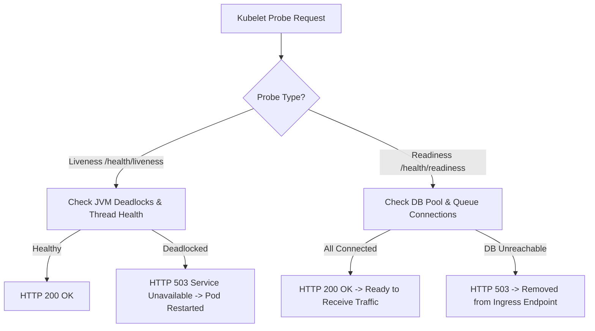

# Deployment Readiness and Production Checklist

This document defines the production verification criteria, health probe behaviors, and operational prerequisites for deploying `tracelyt-notifications`.

---

## 1. Production Readiness Checklist

Before promoting a release of `tracelyt-notifications` to production, verify:

- [ ] **Probes Operational**: `/actuator/health/liveness` and `/actuator/health/readiness` respond with HTTP 200.
- [ ] **Graceful Shutdown Verified**: `server.shutdown=graceful` is enabled, permitting in-flight delivery jobs to complete within the grace period (30s).
- [ ] **Metrics Scraped**: Prometheus endpoint `/actuator/prometheus` is scraped without errors.
- [ ] **Egress Firewalls Cleared**: Network policies permit outbound HTTPS (port 443) to required external provider endpoints.
- [ ] **SSRF Defense Active**: Webhook egress validates IP addresses and blocks private/metadata ranges.
- [ ] **Secrets Injected**: Provider credentials and encryption keys are injected via secure environment variables or vault mounts.
- [ ] **JVM Container Sizing**: `-XX:MaxRAMPercentage=75.0` is configured in container entrypoints.

---

## 2. Health and Liveness Semantics

### 2.1 Liveness Probe
- Indicates whether the JVM process is alive and internal event loops are progressing.
- If liveness fails continuously for 3 consecutive checks (30s), the orchestrator terminates and restarts the container.

### 2.2 Readiness Probe
- Indicates whether the instance can currently accept new intake requests.
- If downstream dependencies (database, broker) are temporarily unavailable, readiness returns HTTP 503, temporarily removing the pod from service discovery without triggering a disruptive container reboot.

---

## 3. Graceful Shutdown Sequence

When a `SIGTERM` signal is received from Kubernetes or the operating system:
1. Readiness probe immediately flips to `DOWN` (HTTP 503) to halt incoming traffic from load balancers.
2. Intake API stops accepting new requests, rejecting them with HTTP 503 and `Retry-After: 5`.
3. In-flight outbound provider deliveries are allowed up to 30 seconds (`spring.lifecycle.timeout-per-shutdown-phase=30s`) to receive provider receipts and persist final state.
4. Active database connection pools and network sockets are closed cleanly.
5. The JVM process exits with status code 0.

---

## 4. Related Documentation

- [Observability](observability.md)
- [Configuration Policy](configuration.md)
- [Deployment Models](../architecture/deployment-models.md)
