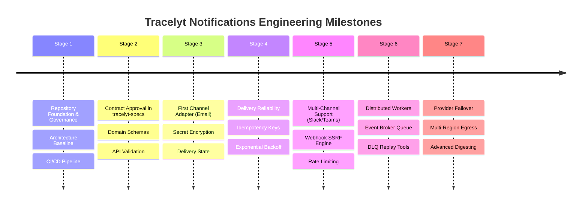

# Development Roadmap

This directory documents the evolutionary milestones, phased development lifecycle, and architectural roadmap for `tracelyt-notifications`.

---

## Roadmap Index

- [Architecture Evolution](architecture-evolution.md) — 7-stage evolution plan from repository foundation to distributed multi-channel delivery.

---

## Milestone Summary

> **Notice**: Dates and milestones are driven strictly by architectural readiness and maintainer review. No speculative dates or unverified feature timelines are published.

---

## Related Documentation

- [Architecture Overview](../architecture/overview.md)
- [System Boundaries](../architecture/system-boundaries.md)
- [ADR Index](../decisions/README.md)
