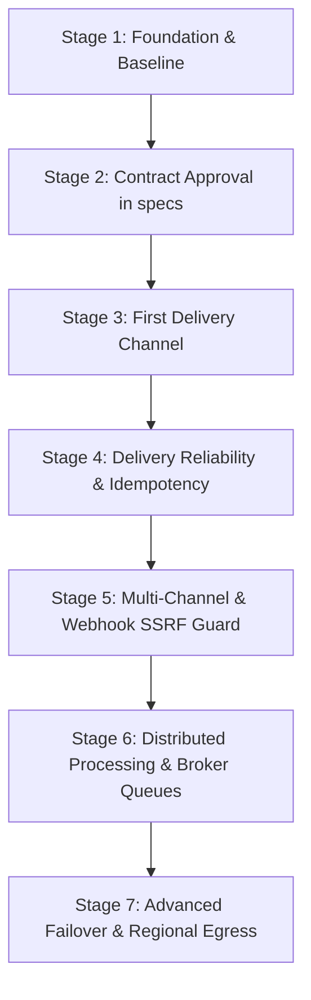

# Architecture Evolution and Progressive Delivery

This document outlines the phased engineering roadmap for evolving `tracelyt-notifications` from its repository foundation into a resilient, production-ready distributed notification delivery platform.

---

## Evolution Stages

---

### Stage 1: Repository Foundation (Current Phase)
- **Status**: Completed / Current Baseline.
- **Objectives**:
  - Establish a clean, maintainable open-source repository foundation.
  - Comprehensive architectural strategies, threat models, and operational documentation.
  - Minimal Java 21 LTS + Spring Boot 3.4.x bootstrap with single-context validation test.
  - Zero checkstyle violations (Checkstyle 10.21.4).
  - Pinned GitHub Actions CI workflows and Dependabot configuration.
  - Strict contract boundary establishing `tracelyt-specs` as canonical source of truth.
- **Boundaries**: Strictly NO notification delivery code, no vendor SDKs, no databases, no mock senders.

---

### Stage 2: Contract and Requirements Approval
- **Status**: Planned / Next Milestone.
- **Objectives**:
  - Define and approve official notification schemas in `tracelyt-specs`:
    - `NotificationRequest` schema (intake intent).
    - `DeliveryStatus` schema and transition event envelope.
    - Idempotency key specifications and tenant identity tokens.
  - Establish contract tests verifying serialization and deserialization.

---

### Stage 3: First Delivery Channel (Transactional Email)
- **Status**: Planned (Requires Implementation Approval).
- **Objectives**:
  - Implement the first single-provider adapter (e.g., AWS SES or Resend via standard HTTP/REST client).
  - Secure credential resolution via `tracelyt-control-plane`.
  - Minimal PostgreSQL state persistence for recording `ACCEPTED` and `DELIVERED` receipts.
  - Basic delivery attempt logging with WireMock integration tests.

---

### Stage 4: Reliability and Failure Handling
- **Status**: Planned.
- **Objectives**:
  - Database-backed transactional outbox and idempotency deduplication table.
  - Exponential backoff with full jitter for transient provider failures (HTTP 429 / 503).
  - Dead-letter queue (DLQ) state transition for unrecoverable errors.
  - Graceful lease reclamation for crashed worker tasks.

---

### Stage 5: Multi-Channel Expansion & Webhook SSRF Engine
- **Status**: Planned.
- **Objectives**:
  - Implement chat channel adapters (Slack, Microsoft Teams, Discord).
  - Implement secure HTTP webhook dispatcher with mandatory SSRF defense, IP address blacklisting, and HMAC-SHA256 request signing.
  - Multi-tier rate limiting (tenant, channel, provider) to prevent notification storms.
  - Safe HTML escaping and template rendering engine.

---

### Stage 6: Distributed Processing (If Workload Justifies)
- **Status**: Planned.
- **Objectives**:
  - Decouple intake API from delivery workers using an asynchronous event broker (Kafka or RabbitMQ).
  - Horizontally scaled worker pools with provider-specific concurrency throttling.
  - Operator tooling for dead-letter inspection and manual message replay.
  - Subsystem operational dashboards and metric alerts.

---

### Stage 7: Advanced High-Availability & Global Routing
- **Status**: Planned.
- **Objectives**:
  - Dynamic provider failover (e.g., automatic fallback from SendGrid to AWS SES upon circuit trip).
  - Regional egress proxy deployment for corporate IP whitelisting.
  - Template localization and recipient timezone-aware routing.
  - Ingestion of approved AI investigation summaries from `tracelyt-ai-investigator`.

---

## Related Documentation

- [Roadmap Overview](README.md)
- [Architecture Overview](../architecture/overview.md)
- [System Boundaries](../architecture/system-boundaries.md)
- [ADR Index](../decisions/README.md)
